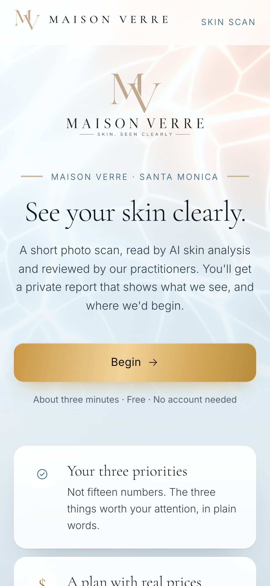
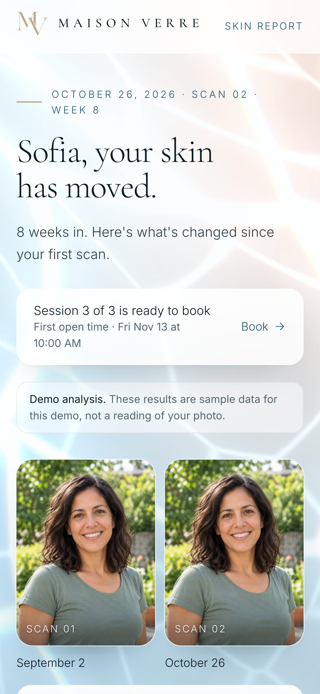
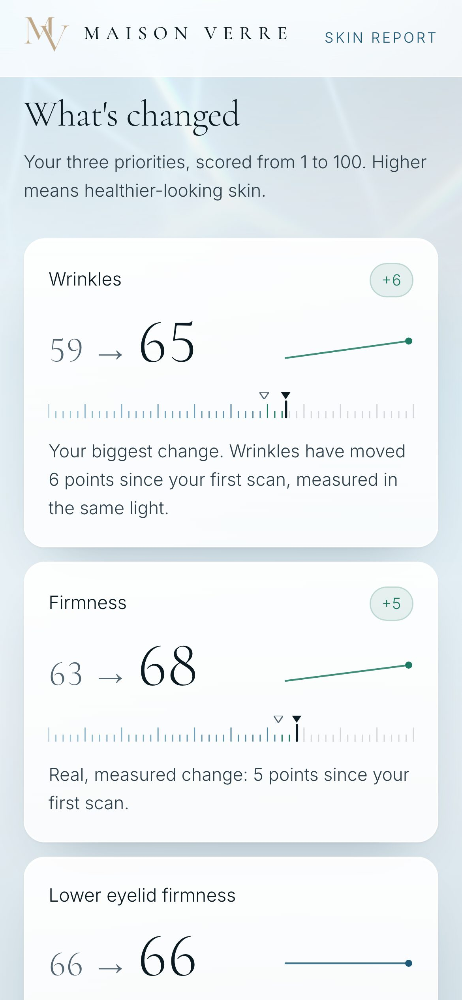
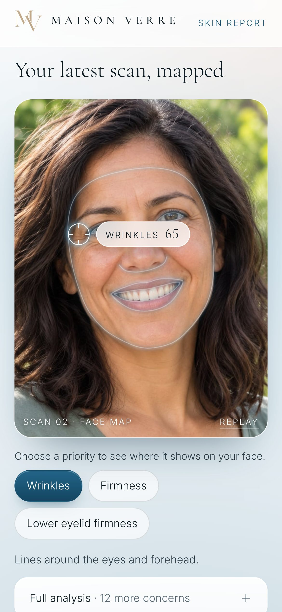
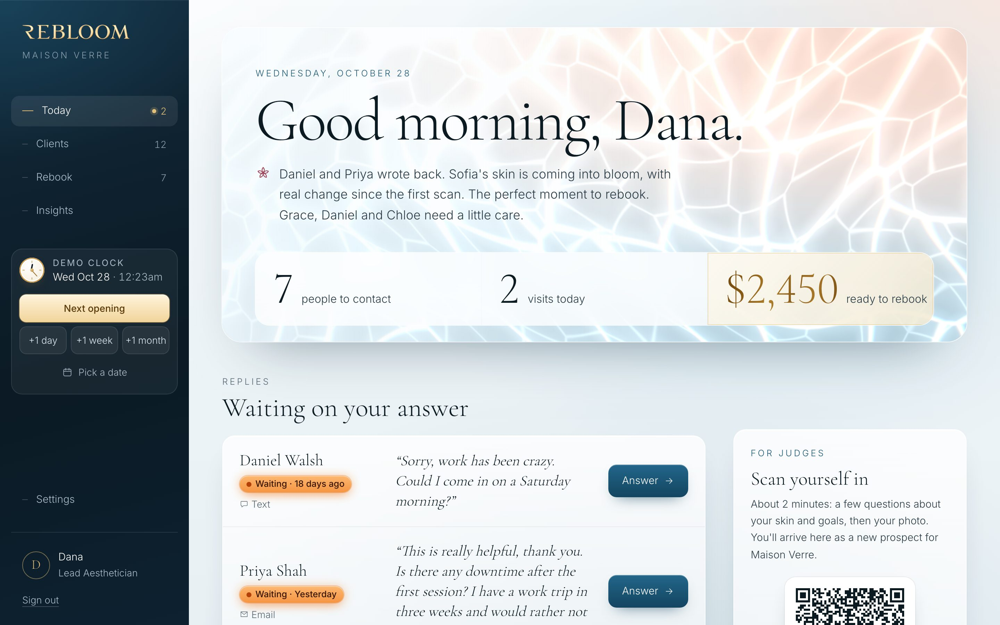
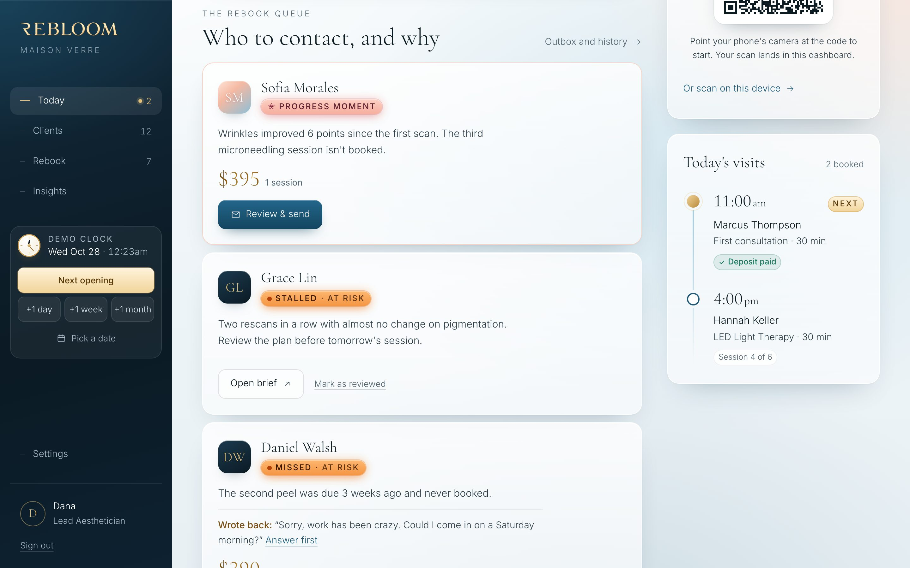
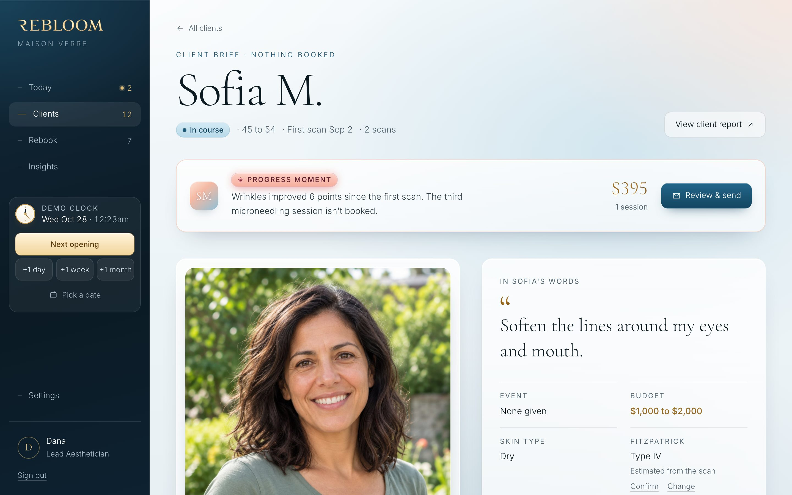
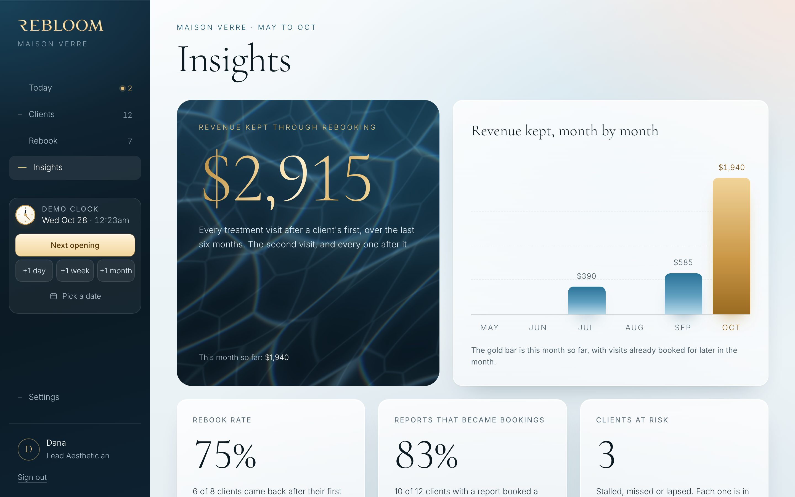
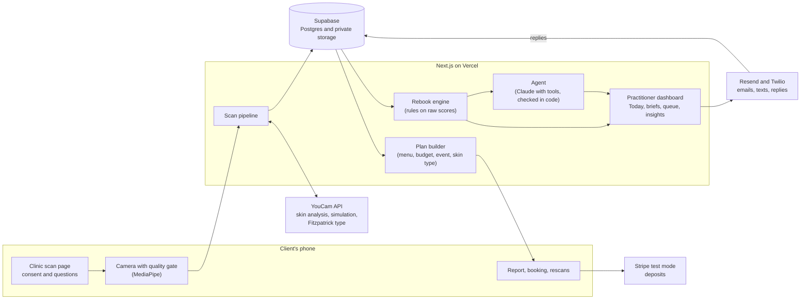

# Rebloom

**The retention engine for skin clinics. Everyone sells the scan. Rebloom sells the result.**

Rebloom turns YouCam's skin analysis into measured proof that a course of treatment is working, and turns that proof into the client's next booking. A client scans their face on their phone and gets a private report in their clinic's name. The practitioner gets a brief, a rebook queue that says who to contact today and why, and an AI agent that drafts every message in her voice, checked in code against the calendar, the menu and the client's own scans. Nothing goes out until she sends it.

Built for Perfect Corp's YouCam API Hackathon, **Skin AI track**. Maison Verre (Santa Monica) and Tidewater Skin Studio (Charleston) are fictional demo clinics.

**Live demo: [www.rebloom.skin](https://www.rebloom.skin)** · no sign-up, works on a phone and a laptop.

---

## Try it in three minutes

1. **Open [www.rebloom.skin](https://www.rebloom.skin) and press "Enter the clinic dashboard".** You're Dana, Lead Aesthetician at Maison Verre, in a private copy of the demo clinic with twelve sample clients. Nobody else sees your copy.
2. **Watch the morning run.** At the top of Today, the agent works through Dana's book: it reads each client's scans, plan and goals, checks the calendar, and drafts every message she needs. Each step shows as it happens.
3. **Open Sofia's row and press "Review draft".** Her wrinkles score moved 6 points between scans, measured in the same light. The draft says so, offers two times that are really open, and links to her booking page. "How it was written" shows every step, including anything the checks sent back. "Use the standard message" swaps in the clinic's own wording.
4. **Scan yourself in.** On Today, point your phone at the "Scan yourself in" code. Answer a few questions, take your photo, and within a minute you appear on the laptop as a new prospect, with your own report and brief.
5. **Move the clock.** The demo clock in the sidebar jumps a day, a week or a month, so you can watch clients come due, drift and get flagged.

Demo emails and texts are logged in the outbox, never sent to the sample clients. In the send sheet you can add your own address to receive a real copy.

## Screenshots


**The client, on their phone,** under the clinic's own name: the scan page, a progress report, what changed since the first scan, and their face map.

<table>
  <tr>
    <td></td>
    <td></td>
    <td></td>
    <td></td>
  </tr>
</table>

**The clinic, on a laptop:** Today, the rebook queue, a client brief and Insights.

<table>
  <tr>
    <td></td>
    <td></td>
  </tr>
  <tr>
    <td></td>
    <td></td>
  </tr>
</table>

## The problem

Skin clinics sell treatment as a series: peels, microneedling, IPL, laser. A client who comes once and disappears is barely profitable, and most don't come back for the second session. They stop because they can't see the first one working, and nobody notices until they're gone.

Clinics already know clients should come back. What's missing is **proof the client can see**, measured honestly, and **a system that notices when someone drifts**, with the right words ready at the right moment.

## How it works

1. **A scan in the clinic's name.** The clinic's scan page (`/c/maison-verre`) takes a new client through consent, seven short questions and a guided photo. Everything carries the clinic's name, logo and colour; Rebloom is one small line in the footer.
   **It's also how new clients find the clinic.** Shared as a link or QR code on the clinic's website, socials or front desk, anyone can scan at home in two minutes. The report opens once they leave their name, email and phone, so every scan becomes a lead in the morning queue, with the plan their report suggested already priced.
2. **A report that tells one story.** Three priorities on their own face map, a plan built only from the clinic's menu with every price shown, an illustration of what the plan could do, and booking with a deposit.
3. **A brief before they walk in.** The practitioner sees the client's goal in their own words, their scores, skin type, screening answers, budget and a suggested plan.
4. **Progress, measured honestly.** Rescans between sessions are compared like with like: same light, same angle, same engine. Real change earns a "progress moment"; a change caused by lighting doesn't.
5. **Who to contact today, and why.** A rules-based rebook engine reads every client's scans and visits each morning and builds the queue: progress moments, missed sessions, new leads, scans due, maintenance, stalled plans, lapsed clients. Each one comes with one plain sentence saying why now.
6. **The agent drafts; the practitioner decides.** Every reply, every queue message and every stalled plan gets a draft in her voice, checked in code. She reads, edits and sends.
7. **The owner sees revenue kept.** Insights show revenue retained through rebooking, the rebook rate, reports that became bookings, and clients at risk.

## How we use the YouCam API

Three YouCam features, all server-side, all on **one photo upload per scan** (`src/lib/youcam/client.ts`).

| Feature | Endpoint | Where it shows | Units |
|---|---|---|---|
| **AI Skin Analysis** (HD, SD fallback) | `POST /s2s/v2.1/task/skin-analysis` | The client's report and the practitioner brief: 15 scored concerns, skin type, skin age, detection masks | 16 to 22 |
| **AI Skin Simulation** | `POST /s2s/v2.0/task/skin-simulation` | "What to expect" on the report: today's photo beside an illustration of the plan | 4 to 6 |
| **AI Fitzpatrick Skin Type** | `POST /s2s/v2.0/task/fitzpatrick-scale-analyzer` | The practitioner brief only, and the plan's safety rule | 10 |

- **AI Skin Analysis (v2.1): 15 scored concerns plus skin type.** HD when the photo's short side is at least 1080 pixels (wrinkles and pores scored by area of the face), SD otherwise; YouCam refusing HD falls back to SD. Upload to a pre-signed URL, start the task, poll it from the browser one short request at a time. Concern names are mapped to client-friendly names and never shown raw.
- **Detection masks** are copied into our private storage on the poll that sees success (YouCam's mask links expire after about two hours), redrawn at the photo's exact size, and shown over the client's own photo as a face map they can tap.
- **AI Skin Simulation** illustrates only the concerns the client's plan treats, at moderate strength, and less when fewer sessions are booked than a full course. Always labelled "An illustration of likely improvement based on your scan. Not a guaranteed result." Never run on demo readings.
- **AI Fitzpatrick Skin Type** (types I to VI) starts beside the analysis on a client's first live scan, on the same upload, and is kept on the client. It's a safety rule for the practitioner, never shown to the client: each treatment carries the highest type the clinic offers it to (the demo menu's IPL: types I to III), and the plan and the agent leave out anything that doesn't suit. The practitioner confirms the estimate or sets the type herself, and can make a recorded exception after a patch test.
- **Then we delete each task at YouCam.** Once the scores, masks, image and type are ours, YouCam no longer holds the client's photo.
- **Units are logged** in `api_usage` for every live call, the setup page shows what's left (`/setup/youcam`), and public scans are capped (5 per browser and per IP a day, a global daily cap and a reserve floor), so the account can't be drained. A capped scan runs as a clearly labelled demo instead of an error.
- **Every YouCam photo error has its own calm instruction** ("Face a window or a bright, even light"), and a network blip never fails a scan.
- **A browser quality gate** (MediaPipe Face Landmarker) checks face size, centring, head pose, light level, evenness, sharpness, eyes open and mouth closed before a photo is taken, with one instruction at a time and auto-capture after a one-second hold. YouCam receives photos it can read reliably, and rescans are comparable.

### ui_score versus raw_score

YouCam's `ui_score` is adjusted upward as a motivator; `raw_score` is the underlying measurement.

- Clients see `ui_score`, as in Perfect Corp's own products.
- **Every progress claim, delta and rebooking trigger uses `raw_score`.** A change only earns a celebration when the raw change clears a threshold set by measuring how much scores move with lighting alone, and only when both scans passed the same capture checks.
- Practitioners see both.

We measure progress on the raw data, not the flattering number.

## The agent

The hackathon asks for agentic workflows. Rebloom's agent doesn't talk to clients. It prepares the practitioner's desk, and everything it says is checked in code before she sees it.

- **What it does.** It answers client replies (Daniel texted to ask for a Saturday morning: the draft offers Saturday mornings that are really open). It takes a second look at stalled plans: first it checks in code whether the last scans can be compared at all, and asks for a two-minute rescan if not; if the stall is real, it proposes one change from the menu, priced, for the practitioner to discuss. And in the **morning run**, it writes her own version of every message in the rebook queue, using the client's goal in their own words, the change their scans actually show, and two open times.
- **How it works.** Claude works through tools that read the same rows and rules the dashboard uses: `read_conversation`, `read_client`, `read_scans`, `read_plan`, `read_menu`, `find_open_times` (the real booking calendar), `check_measurement`, `suggest_plan_change` and `submit_draft` (`src/lib/agent/tools.ts`).
- **Checked in code, not just asked for** (`src/lib/agent/guard.ts`). A draft is sent back to the agent, inside the same run, when it:
  - names a time the calendar tool didn't return, or a time without am or pm;
  - quotes a price that isn't on the menu or the client's plan;
  - claims a number of points of progress the report doesn't call a real change;
  - carries a link that isn't the client's own report, booking or rescan page;
  - uses an em dash, a banned word, or a tell of machine writing ("great question", "reach out", emoji);
  - doesn't sign off the way she does.
- **It learns her voice.** Each run reads the messages she wrote herself and the drafts she changed before sending, with what she sent instead.
- **Safety valves.** Daily caps per demo and overall, a turn limit per run, and a fallback for every failure: the standard message stays, and she writes it herself.
- **Never on its own.** No draft is sent, no time is booked and no plan is changed without the practitioner.

## Architecture



| Area | Where |
|---|---|
| YouCam client, parsing, units | `src/lib/youcam/` |
| Capture quality gate | `src/lib/capture/`, `src/components/capture/` |
| Report and progress | `src/app/r/[token]/`, `src/lib/report/` |
| Plan builder | `src/lib/plan/build.ts` |
| Rebook engine | `src/lib/rebook/engine.ts` |
| Agent | `src/lib/agent/` |
| Dashboard | `src/app/dashboard/`, `src/components/dashboard/` |
| Database schema | `supabase/migrations/` |

## Run it locally (no keys needed)

Requires Node 22 and pnpm.

```bash
pnpm install
pnpm dev
```

Open http://localhost:3000. With no environment variables, Rebloom uses a local file store in `.data/` and **fixture mode**: realistic sample skin results with zero API calls, clearly labelled "Demo analysis". Everything else works: the scan flow, reports, booking, the dashboard and the demo clock. The camera needs `localhost` or HTTPS.

To use real services, copy `.env.example` to `.env.local` and fill in what you have. Each variable is explained there.

| To switch on | Set |
|---|---|
| Live YouCam analysis | `YOUCAM_API_KEY` and `YOUCAM_MODE=live` |
| Supabase instead of the local file store | `NEXT_PUBLIC_SUPABASE_URL`, `NEXT_PUBLIC_SUPABASE_ANON_KEY`, `SUPABASE_SERVICE_ROLE_KEY` |
| The agent, and reading the client's own words | `ANTHROPIC_API_KEY` |
| Email, and replies landing on the brief | `RESEND_API_KEY`, `EMAIL_FROM`, `REPLY_DOMAIN`, `RESEND_WEBHOOK_SECRET` |
| Texts | `TWILIO_ACCOUNT_SID`, `TWILIO_AUTH_TOKEN`, `TWILIO_FROM` |
| Booking deposits (test mode only) | `STRIPE_SECRET_KEY` (must start with `sk_test_`) |

To check a YouCam key without spending units, open `/setup/youcam` and enter the `CRON_SECRET`, or:

```bash
curl -H "Authorization: Bearer $CRON_SECRET" http://localhost:3000/api/youcam/check
```

## Checks

```bash
pnpm typecheck     # TypeScript
pnpm lint          # ESLint
pnpm test          # 500+ unit tests: the gate, the clock, YouCam parsing, the plan, the rebook engine, the agent's checks, the store
pnpm test:e2e      # browser tests of the client flow and the dashboard, in fixture mode with the local store
pnpm test:e2e:live # the same flow in live mode, against a local stand-in for YouCam's API (no units spent)
pnpm test:supabase # the Supabase store against a real project (needs keys; cleans up after itself)
pnpm check:copy    # no em dashes anywhere in the source
```

## Database

The schema lives in `supabase/migrations`: tables, row level security on everything with no public policies, and the private `scans` photo bucket.

```bash
pnpm db:migrate    # apply new migrations through Supabase's Management API
pnpm db:seed       # upsert the demo clinics, staff, treatments and products from src/data
pnpm db:status     # what's applied, row counts, and whether the photo bucket is private
```

These need `SUPABASE_ACCESS_TOKEN` and `SUPABASE_PROJECT_REF`. Add `--print` to `db:migrate` or `db:seed` to print the SQL instead, for pasting into Supabase's SQL editor.

## Stack

Next.js 16 (App Router, TypeScript), Tailwind CSS 4, Supabase (Postgres and private Storage), YouCam API, MediaPipe Tasks Vision, Anthropic Claude (the agent, and reading the client's own words), Resend (email and replies), Twilio (texts), Stripe (test mode only), Vercel.

## Privacy by design

- Explicit biometric consent before the camera opens, with a versioned consent record.
- Photos in private storage, shown only through short-lived links scoped to the client's own report.
- YouCam's copy of each photo deleted as soon as the results are ours.
- Hashed IP addresses; raw IPs are never stored.
- One-tap "Delete my data" on every report.
- Every reminder email carries a working unsubscribe, honoured everywhere, and every text a way to opt out.
- One private demo per visitor, cleared after 30 days, so no visitor ever sees another visitor's face.
- Cosmetic, never medical: the report describes how skin looks, and screening answers are prompts for the practitioner, never advice in writing.

## Project documents

- `PRODUCT.md`: who it's for and the principles behind it.
- `BRIEF.md`: the original product brief.
- `DECISIONS.md`: every product and technical decision, with reasons.
- `PROGRESS.md`: what was built in each session.

## Copyright

© 2026 Joshua James. All rights reserved. This repository is shared privately with Perfect Corp for judging the YouCam API Hackathon. No licence is granted to copy, modify or distribute it.
